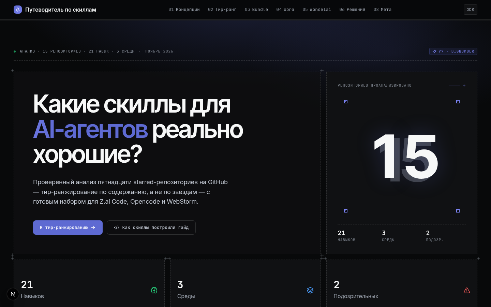

# Путеводитель по скиллам для AI-агентов

> Какие скиллы для AI-агентов реально хорошие? — проверенный анализ 15 starred-репозиториев на GitHub с тир-ранжированием по содержанию, а не по звёздам, и готовыми bundle-наборами для Z.ai Code, Opencode и WebStorm.



## Что внутри

- **§01 Концепции** — две разные вещи, которые называют «скиллами» (Z.ai Skill tool vs agentskills.io SKILL.md)
- **§02 Тир-ранжирование** — 15 репозиториев с sidebar-навигацией и scroll-spy, карточки с табами «Зачем / Ценность / Когда»
- **§03 Bundle-наборы** — готовые наборы для Z.ai Code, Opencode, WebStorm
- **§04 obra/superpowers** — deep dive по 7 процессным навыкам с Iron Laws
- **§05 wondelai/skills** — deep dive по 16 принципиальным навыкам с routing-правилами
- **§06 Дерево решений** — 27 симптомов → навык
- **§07 Чек-лист качества** — 9 вопросов для проверки любого skill-репо
- **§08 Мета** — как скиллы из этого гайда построили сам гайд

## Технологии

- **Next.js 16** (App Router) + TypeScript 5
- **Base UI** (`@base-ui-components/react`) — headless-компоненты (Tabs, Accordion)
- **Tailwind CSS 4**
- **Lucide** иконки + custom SVG (corner-crosses)
- **Design-kit** приёмы: BorderBeam, ShinyText, GlareHover, NumberTicker, TextHighlighter, ProgressiveBlur
- **Inter Tight** (display) + **Inter** (body) + **JetBrains Mono** (data)

## Структура проекта

```
src/
├── app/
│   ├── page.tsx              # тонкая сборка секций
│   ├── layout.tsx            # шрифты + metadata
│   └── globals.css           # Linear-палитра + design-kit CSS
├── components/guide/         # 21 компонент
│   ├── StickyNav.tsx         # sticky nav с §-нумерацией
│   ├── Hero.tsx              # bento grid + BigNumber
│   ├── BigNumber.tsx         # цифра-герой с double-layer + anchor-points
│   ├── NumberTicker.tsx      # count-up анимация (design-kit #19)
│   ├── ConceptExplainer.tsx  # Z.ai vs agentskills.io
│   ├── TierRanking.tsx       # 15 репо + sidebar + scroll-spy
│   ├── RepoSidebar.tsx       # sticky sidebar с scroll-spy
│   ├── RepoCard.tsx          # карточка с табами Зачем/Ценность/Когда
│   ├── Bundles.tsx           # bundle для 3 сред
│   ├── ObraDeepDive.tsx      # 7 навыков obra
│   ├── WondelaiDeepDive.tsx  # 16 навыков wondelai
│   ├── DecisionTree.tsx      # 27 симптомов → навык
│   ├── QualityChecklist.tsx  # 9 вопросов
│   ├── MetaSection.tsx       # мета-демонстрация
│   ├── Footer.tsx
│   ├── CornerCrosses.tsx     # blueprint corner markers
│   ├── ClientOnly.tsx        # SSR-safe wrapper для Base UI
│   ├── SectionHeading.tsx    # заголовки секций
│   ├── icons.tsx             # custom SVG-иконки
│   ├── meta-steps.ts         # данные секции «Мета»
│   └── tier-config.ts        # shared UI helpers
└── lib/data/                 # данные (модульно)
    ├── types.ts              # shared interfaces
    ├── repos.ts              # 15 репозиториев
    ├── obra-skills.ts        # 7 навыков obra
    ├── wondelai-skills.ts    # 16 навыков wondelai
    ├── decision-tree.ts      # 27 routing-правил
    ├── bundles.ts            # 3 bundle для сред
    └── index.ts              # barrel export

docs/skills/README.md         # манифест загруженных skills
```

## Запуск локально (Windows)

### Требования

- **Node.js 20+** (LTS) — [скачать](https://nodejs.org/)
- **npm** (устанавливается вместе с Node.js)
- **Git** — [скачать](https://git-scm.com/download/win)

### Установка и запуск

```powershell
# 1. Клонировать репозиторий
git clone https://github.com/stsgs1980/skill-guide.git
cd skill-guide

# 2. Установить зависимости
npm install

# 3. Запустить dev-сервер
npm run dev
```

Откройте http://localhost:3000 в браузере.

### Скрипты

| Команда              | Описание                            |
| -------------------- | ----------------------------------- |
| `npm run dev`        | Dev-сервер на http://localhost:3000 |
| `npm run lint`       | ESLint проверка                     |
| `npm run type-check` | TypeScript type-check               |
| `npm run format`     | Prettier форматирование             |
| `npm run stylelint`  | Stylelint проверка CSS              |
| `npm run build`      | Production-сборка                   |
| `npm run start`      | Запуск production-сервера           |

### Переменные окружения

Создавать `.env` **не нужно**: проект работает без обязательных env-переменных — все данные статичны в `src/lib/data/`. Файл `.env.example` оставлен как шаблон на случай, если позже появятся auth, AI или база данных.

## Деплой на Vercel

### Вариант 1: Через Vercel Dashboard (рекомендуется)

1. **Загрузите проект на GitHub:**

   ```powershell
   git init
   git add .
   git commit -m "Готовый путеводитель по скиллам"
   git branch -M main
   git remote add origin https://github.com/stsgs1980/skill-guide.git
   git push -u origin main
   ```

2. **Импортируйте на Vercel:**
   - Откройте [vercel.com/new](https://vercel.com/new)
   - Выберите ваш GitHub-репозиторий
   - Vercel автоматически определит Next.js — настройки по умолчанию корректны:
     - **Framework Preset:** Next.js
     - **Build Command:** `npm run build`
     - **Output Directory:** `.next`
     - **Install Command:** `npm install`

3. **Нажмите Deploy** — через ~2 минуты сайт будет доступен по адресу `https://<project>.vercel.app`

### Вариант 2: Через Vercel CLI

```powershell
# 1. Установить Vercel CLI
npm install -g vercel

# 2. Авторизоваться
vercel login

# 3. Деплой (из папки проекта)
vercel

# 4. Production-деплой
vercel --prod
```

### Настройки Vercel (vercel.json)

Файл `vercel.json` уже включён в проект:

```json
{
  "$schema": "https://openapi.vercel.sh/vercel.json",
  "framework": "nextjs",
  "buildCommand": "npm run build",
  "devCommand": "npm run dev",
  "installCommand": "npm install",
  "regions": ["fra1"]
}
```

- **Region:** `fra1` (Франкфурт) — ближайший к EU
- **Install:** `npm install`
- **Build:** `npm run build`

### Переменные окружения на Vercel

Для этого проекта **не требуются** — все данные статичны в `src/lib/data/`.

## Особенности реализации

### Design-kit компоненты (6 применённых)

| #   | Компонент       | Где                                     |
| --- | --------------- | --------------------------------------- |
| 6   | BorderBeam      | Карточка rank 1 в TierRanking           |
| 8   | GlareHover      | Карточка rank 1 в TierRanking           |
| 11  | ProgressiveBlur | CSS-класс `.progressive-blur`           |
| 15  | ShinyText       | «AI-агентов» в Hero h1                  |
| 17  | TextHighlighter | «скиллами» в заголовке ConceptExplainer |
| 19  | NumberTicker    | «15» в BigNumber Hero                   |

Все анимации уважают `prefers-reduced-motion`.

### Hydration-safe Base UI

Base UI Tabs использует `useId()` для внутренних ID, что вызывает hydration mismatch при SSR. Решение — `ClientOnly` wrapper на `useSyncExternalStore`:

```tsx
<ClientOnly fallback={<FallbackContent />}>
  <BaseTabs.Root>...</BaseTabs.Root>
</ClientOnly>
```

Сервер и первый client-render показывают fallback, после mount — Base UI. Нет hydration errors.

### Scroll-spy sidebar

`RepoSidebar` использует scroll-based detection (не IntersectionObserver) для надёжности с карточками разной высоты:

```js
const TRIGGER_LINE = 120 // px под sticky nav
// Активная карточка = та, чья top пересекла trigger line, но не ушла далеко вверх
```

После клика — `lockRef` блокирует observer на 1.2с, чтобы smooth scroll не перезаписал active.

## Проверка качества

```powershell
# ESLint
npm run lint

# TypeScript
npm run type-check

# Production build
npm run build
```

Все три проверки проходят без ошибок.

## Источники данных

- [GitHub stars @stsgs1980](https://github.com/stsgs1980?tab=stars) — список 15 репозиториев
- [obra/superpowers](https://github.com/obra/superpowers) — 7 процессных навыков
- [wondelai/skills](https://github.com/wondelai/skills) — 16 принципиальных навыков
- [skills.wondel.ai](https://skills.wondel.ai/skills/code/) — routing-правила

## Лицензия

MIT — используйте свободно.

---

**Построено с:** Next.js 16 · Base UI · Tailwind CSS 4 · Lucide · Linear-inspired dark palette · design-kit приёмы
